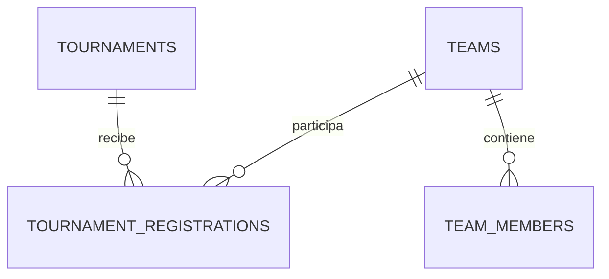

# Base de datos y migraciones

El proyecto utiliza PostgreSQL 17, ejecutado localmente con Docker Compose, y
Sequelize como ORM. Este documento describe el esquema actual y cómo debe
evolucionar sin perder sincronización entre ambientes.

## Modelo actual



### `tournaments`

Almacena nombre, descripción, modalidad, cupo, fechas, estado y
`organizer_id`. Los identificadores son enteros autoincrementales.

Índices principales:

- `organizer_id`;
- `status`.

### `teams`

Almacena nombre, descripción y `captain_id`. El capitán se incorpora también
a `team_members` cuando se crea el equipo.

### `team_members`

Relaciona equipos con identificadores numéricos de usuarios.

- `team_id` referencia `teams.id`.
- La eliminación de un equipo elimina sus integrantes mediante `CASCADE`.
- La combinación `team_id + user_id` es única.

### `tournament_registrations`

Relaciona torneos y equipos con estado `registered` o `withdrawn`.

- `tournament_id` referencia `tournaments.id`.
- `team_id` referencia `teams.id`.
- Ambas claves usan `ON DELETE RESTRICT` para conservar el historial.
- La combinación `tournament_id + team_id` es única.

## Integración pendiente con usuarios

`tournaments.organizer_id`, `teams.captain_id` y
`team_members.user_id` ya almacenan enteros positivos, pero todavía no poseen claves
foráneas hacia `users.id`.

Cuando la tabla `users` esté disponible se deben crear migraciones nuevas para:

- agregar las claves foráneas;
- utilizar `ON UPDATE CASCADE`;
- utilizar `ON DELETE RESTRICT` donde exista información histórica;
- agregar las asociaciones de Sequelize;
- devolver datos públicos del usuario en lugar de solamente su identificador.

Las migraciones existentes no deben modificarse para incorporar esta relación.

## Identificadores simplificados del prototipo

Las entidades del bloque utilizan `INTEGER` autoincremental para facilitar las
pruebas, las URLs y la integración con `users.idUsuario`. El tipo se encuentra
centralizado en el schema `backend/schemas/id.schema.js` y en el tipo
`frontend/src/types/id.ts`, por lo que el resto del código trata cada ID como
un valor opaco.

La migración `005-simplify-prototype-identifiers.cjs` reconstruye las cuatro
tablas de este bloque y elimina sus datos de prueba. Esta pérdida fue aceptada
porque todavía no existe información productiva. La migración no elimina ni
modifica la tabla de usuarios.

Si más adelante se adopta UUID u otro esquema, se deberá crear una migración
nueva, mantener el contrato `id` de la API y actualizar únicamente los tipos y
validaciones centrales.

## Convención de nombres

Los archivos de `backend/migrations` siguen esta estructura:

```text
NNN-accion-recurso.cjs
```

Ejemplo:

```text
001-create-tournaments.cjs
```

- `001`: número secuencial de tres dígitos utilizado para ordenar migraciones.
- `create-tournaments`: descripción breve de la operación.
- `.cjs`: CommonJS, formato utilizado por Sequelize CLI mientras la
  aplicación usa módulos ES.

La parte descriptiva ayuda a reconocer la finalidad del archivo; no define el
nombre de la tabla. El número debe ser único, usar ceros a la izquierda y
respetar las dependencias entre cambios. La próxima migración toma el número
siguiente disponible; por ejemplo, después de `005` corresponde `006`.

Si Sequelize CLI genera automáticamente un archivo con una marca temporal, se
debe renombrar a esta convención antes de ejecutarlo o compartirlo.

## Operaciones de una migración

Cada archivo contiene:

- `up`: aplica el cambio;
- `down`: revierte el cambio.

Sequelize registra el nombre completo de cada migración aplicada en
`SequelizeMeta`. Una migración ejecutada no debe:

- renombrarse;
- eliminarse;
- reescribirse para introducir un cambio nuevo.

Las modificaciones posteriores requieren otra migración con el siguiente
número. Una migración nueva siempre parte del estado actual del esquema: no se
inserta un número menor para intentar ejecutarla antes que cambios ya aplicados.
Alterar o reordenar el historial aplicado puede desincronizar las bases de datos
del equipo.

Los archivos se renombraron a esta convención mientras la información era de
prueba. Por ese motivo, las bases locales que todavía registren los nombres
anteriores deben recrear estas tablas y su historial de migraciones antes de
ejecutar la nueva secuencia.

## Comandos

Iniciar todo el sistema y aplicar migraciones automáticamente:

```bash
npm run docker:up
```

Iniciar solamente PostgreSQL para desarrollo local con Node:

```bash
docker compose up -d postgres
```

Comprobar el contenedor:

```bash
docker compose ps
```

Aplicar migraciones:

```bash
npm run db:migrate
```

Ejecutar el seeder de demostración:

```bash
npm run db:seed
```

El archivo `backend/seeders/001-demo-data.cjs` carga 6 torneos, 16 equipos,
96 integrantes y sus inscripciones. `SequelizeData` registra su ejecución, por
lo que repetir el comando no duplica registros.

Retirar solamente los datos creados por los seeders:

```bash
npm run db:seed:undo
```

Los IDs de usuario son temporales y no tienen clave foránea hasta integrar el
módulo de autenticación. Los registros manuales no forman parte del `down` del
seeder.

Detener PostgreSQL conservando los datos:

```bash
docker compose down
```

El volumen `postgres_data` mantiene la información entre reinicios. Eliminar
el volumen borra los datos locales y solo debe hacerse de manera intencional.

Como las migraciones iniciales se renombraron de marcas temporales a la
secuencia `001` a `005`, las bases locales anteriores deben reconstruirse una
sola vez. Este procedimiento está permitido únicamente mientras contengan
datos de prueba:

```bash
docker compose down -v
npm run docker:up
```

## Reglas para cambios del esquema

1. Crear una migración nueva y descriptiva.
2. Definir `up` y `down`.
3. Proteger integridad con nulabilidad, unicidad, índices y claves foráneas.
4. Aplicar la migración sobre una base local.
5. Ejecutar pruebas.
6. Documentar cualquier cambio visible en el contrato de la API.
7. Commitear la migración junto con modelos, pruebas y documentación asociados.
