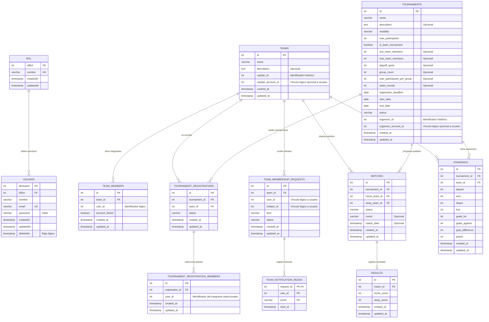

# Diagrama entidad-relación

El diagrama representa el esquema de la API, incluidas las cuentas, las
membresías y los planteles inscritos. Las líneas muestran claves foráneas
existentes. Las referencias lógicas a cuentas se indican en cada campo.

## Restricciones relevantes

- `team_members.team_id` referencia a `teams.id` con actualización y borrado
  en cascada.
- `tournament_registrations.tournament_id` referencia a `tournaments.id`.
- `tournament_registrations.team_id` referencia a `teams.id`.
- La combinación de torneo y equipo es única en
  `tournament_registrations`.
- La combinación de equipo y usuario es única en `team_members`.
- Cada partido relaciona un torneo con dos equipos diferentes.
- `results.match_id` es único, por lo que cada partido tiene como máximo un
  resultado.
- La combinación de torneo y equipo es única en `standings`.
- `organizer_account_id`, `captain_account_id` y los IDs de cuenta de
  membresías y avisos son vínculos lógicos. La aplicación valida las cuentas
  activas al ejecutar las acciones correspondientes.
- Las solicitudes e invitaciones comparten un índice único parcial por equipo
  y cuenta mientras están pendientes. Las lecturas se identifican por trámite,
  cuenta y evento.
- Las tablas de partidas, resultados y posiciones forman parte del esquema.
  Su integración en la API sigue pendiente.
