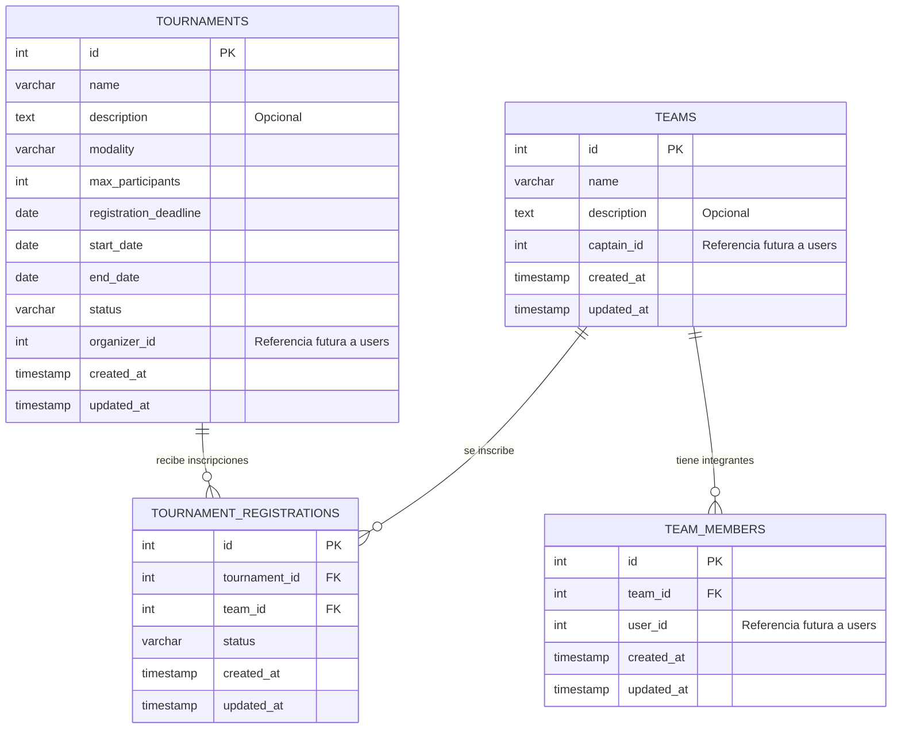

# Diagrama entidad-relación

El diagrama representa el esquema implementado para torneos, equipos,
integrantes e inscripciones después de simplificar los identificadores del
prototipo a enteros autoincrementales.

## Restricciones relevantes

- `team_members.team_id` referencia a `teams.id` con actualización y borrado
  en cascada.
- `tournament_registrations.tournament_id` referencia a `tournaments.id`.
- `tournament_registrations.team_id` referencia a `teams.id`.
- La combinación de torneo y equipo es única en
  `tournament_registrations`.
- La combinación de equipo y usuario es única en `team_members`.
- `organizer_id`, `captain_id` y `user_id` son referencias lógicas. Todavía no
  tienen claves foráneas porque el módulo `users` está pendiente de integración.
